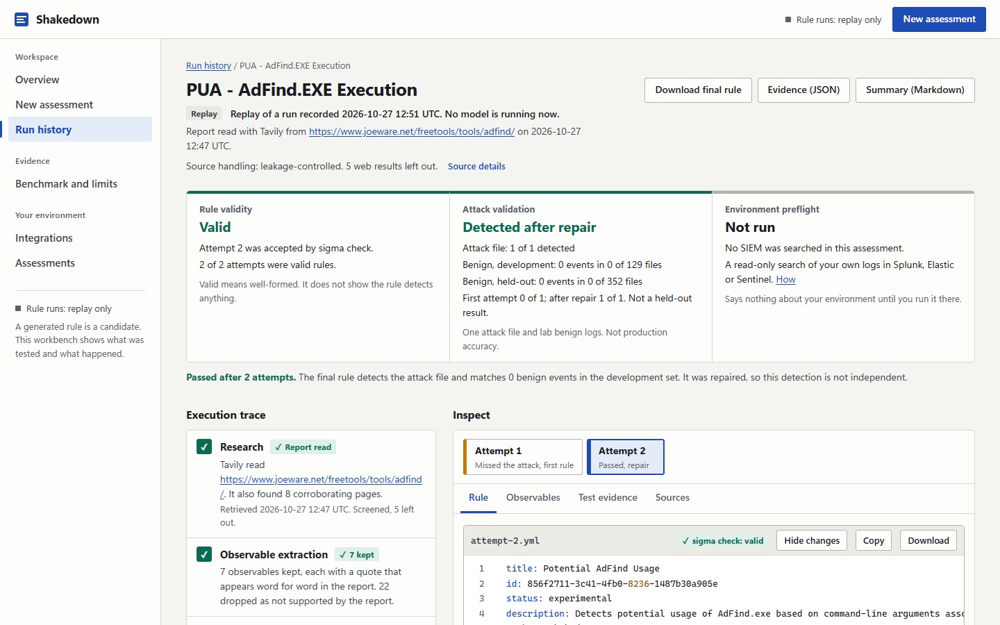
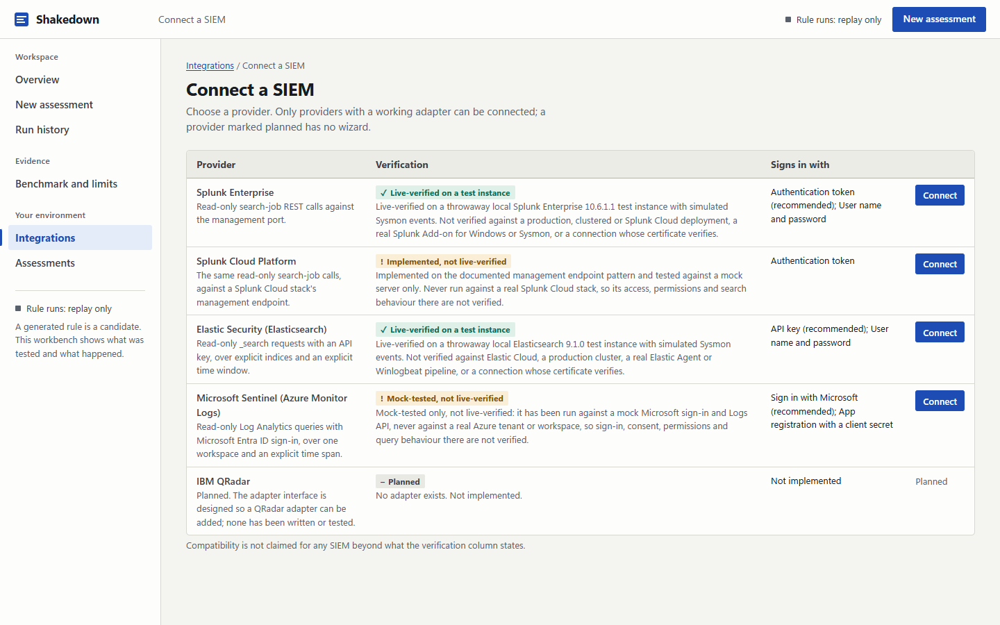

# Shakedown

**Detection rules that come with test results.**

Shakedown turns a threat report into a Sigma detection rule and then tests it: a Nemotron model on Nebius Token Factory writes the rule, and a Token Factory Sandbox runs it against a real attack log and against benign Windows logs. You get the rule and the evidence together, including when it fails.

Built for the Nebius x NVIDIA Global AI Hackathon, Coding and Agentic Engineering track, with Tavily for research.

| | |
|---|---|
| Hosted demo | [[pending: the hosted demo URL does not exist yet]] |
| Video | [[pending: the YouTube URL does not exist yet]] |
| Try it now, no accounts | `uv sync && uv run python -m shakedown.serve --port 8000` (replay of real recorded runs) |



*A replay of a real run (the page says so: "Replay of a run recorded ... No model is running now"). Attempt 1 missed the attack; attempt 2, written after seeing the missed events, detects it with 0 benign matches on 129 development and 352 held-out log files. The three verdicts are separate, and the third (environment preflight) is "Not run" because no SIEM was searched. A failed run is shown just as plainly: [one that did not pass](docs/images/replay-adfind-enumeration-failure.png).*



*The Integrations workspace (`--integrations`, local only). Each provider states what was actually verified. Splunk Enterprise and Elastic were verified only on throwaway local test instances with simulated events; Splunk Cloud and Sentinel were never run against the real service.* A connection page and a preflight result from the local Splunk test instance (simulated Sysmon events, certificate checking off, as the page says): [connection](docs/images/integrations-connection.png), [result](docs/images/integrations-preflight-result.png).

## The problem

When a new attack is reported, defenders have to turn the report into a detection rule. AI can write Sigma YAML in seconds, but a rule that looks valid can still miss the attack or fire on normal activity, and a generated rule normally arrives with no evidence either way. Shakedown's output is not "here is a rule" but "here is a rule, here is the attack it caught, and here are the 481 benign log files it did not fire on."

## What happens in a run

1. **Tavily** reads the report page and searches for corroborating sources. Web text is labelled untrusted before it reaches the model. Search results that look like the rule being written (a copy of its YAML, a known Sigma mirror, a page titled like it) are left out, and every source, its time and the decision are stored in the run record. See [the leakage audit](evidence/leakage_audit/REPORT.md).
2. **Nemotron 3 Super 120B** (through Token Factory) extracts a typed spec. Each observable must come with a quote that appears verbatim in the report, or it is dropped.
3. Nemotron writes the rule as JSON fields; our code renders the Sigma YAML and assigns the rule id.
4. `sigma check` validates it.
5. **A Token Factory Sandbox** (a microVM with no network) runs SigmaHQ's own checker, `evtx-sigma-checker`, on the attack log and on benign Windows logs.
6. If the attack was missed or a benign event matched, the exact evidence goes back to the model for a repair, at most three.
7. The best attempt is tested once more on benign logs the model never saw and compared with SigmaHQ's expert rule for the same behaviour.

The page shows every attempt, the diff between attempts, the evidence, which model or tool did what, whether the run is live or a replay, and how web sources were handled.

## Where each piece runs

| Piece | Role |
|---|---|
| Nemotron 3 Super 120B on Nebius Token Factory | Extracts the spec, writes and repairs the rule (structured JSON output). A runtime call on every run |
| Token Factory Sandboxes (beta) | Runs SigmaHQ's checker on candidates in a disposable microVM with `networking.enabled=false` |
| Tavily | Reads and searches the web for the threat report at run time (one extract and one search per run) |
| `sigma check` | Validates rule files |

More in [docs/ARCHITECTURE.md](docs/ARCHITECTURE.md); design decisions in [docs/DECISIONS.md](docs/DECISIONS.md).

## Results

Measured on SigmaHQ regression data: one attack log per rule; benign lab logs (`win7-x86` for development, `win10-client` held out). **Twenty tasks frozen before any run on them** (10 dated 2026), evaluated in a Token Factory Sandbox. The benchmark gives the model a SigmaHQ rule's title, description, references and tags, and never used web research. Full tables, method and every change made after seeing results: [docs/RESULTS_TABLE.md](docs/RESULTS_TABLE.md), [docs/EVALUATION_METHODOLOGY.md](docs/EVALUATION_METHODOLOGY.md).

| | Run 8 (headline) | Run 9 (comparison) |
|---|---|---|
| Tasks that produced a result | 19 of 20 (one task got no JSON from the model three times and errored) | 20 of 20 |
| First attempt detects the attack | 7 of 19 | 6 of 20 |
| After up to 3 repairs | 14 of 19 (14 of 20 counting the errored task as a miss) | 14 of 20 |
| SigmaHQ expert rule | 19 of 19 | 20 of 20 |
| Repaired rules that matched held-out benign logs | 1 of 19 (1 event) | 1 of 20 (2 events) |

- Repair roughly doubled detection of the attack file.
- **Expert rules are still better.** Shakedown does not match them. It produces a tested rule with evidence from a description, which is the part that is usually missing.
- After a repair, detection is judged on the same attack file whose missed events the model saw, so it is **not** a held-out result. Only the first-attempt numbers and the held-out benign counts are clean.
- Samples are small, run-to-run noise is large, the data is lab data. See [docs/LIMITATIONS.md](docs/LIMITATIONS.md).

**Live runs, separate from the benchmark** (exploratory, not part of the table above; [docs/DEMO_DECISION.md](docs/DEMO_DECISION.md)): with answer-bearing web pages excluded, "PUA - AdFind.EXE Execution" passed in 6 of 6 runs (zero held-out benign events each), and the sibling AdFind Enumeration scenario in 3 of 4; the failure is shown. Six passes on one scenario is a demonstration, not a success rate.

## Try it

**Replay** (no credentials, calls nothing) plays back real recorded runs, including ones that failed. The default folder, `demo/replay`, holds leakage-controlled runs only. Recordings made before answer screening (`demo/recorded`, `demo/recorded_local`) are kept, labelled in the app and are not evidence; see [demo/README.md](demo/README.md).

```bash
uv sync
uv run python -m shakedown.serve --port 8000     # open http://127.0.0.1:8000
```

**Live** runs the whole pipeline. It needs a Token Factory key, a Sandboxes-enabled project, a Tavily key, and the datasets:

```bash
# .env (git-ignored), or real environment variables
NEBIUS_API_KEY=...
NEBIUS_PROJECT_ID=...
TAVILY_API_KEY=...

uv run python tools/fetch_data.py                  # pinned SigmaHQ commit + evtx-baseline v0.8.5, hashes verified (~150 MB)
uv run python tools/build_sandbox_image.py         # once: builds the evaluation image in your Sandbox project
uv run python -m shakedown.serve --live --port 8000 --allow-custom-url
```

Useful flags: `--runner local` evaluates in a local Docker container instead of a Sandbox; `--answer-policy flag` shows flagged web sources to the model and records them (research mode, not a clean test); `--daily-cap`, `--total-cap`, `--budget-file`, `--cooldown`, `--max-concurrent` bound spend. Without `--allow-custom-url` a visitor can only run a scenario's own reference page. A `Dockerfile` for a hosted, capped instance is included; see [docs/HOSTING_PLAN.md](docs/HOSTING_PLAN.md). Check a running server with `python tools/smoke_hosted.py http://127.0.0.1:8000`.

**Tests:** `uv run pytest` (the full suite needs Docker and the datasets for 6 integration tests, which are skipped without them; a fresh copy without datasets passes the rest). Paid external-API tests never run by default.

## Beyond lab scenarios: assess a rule against your own evidence

A local, command-line workflow, separate from the benchmark and from the hosted demo (which never accepts uploads):

```bash
uv run python -m shakedown.assess --rule rule.yml --manifest case/manifest.yml --splunk --splunk-index win_sysmon --last-hours 24 --out packet/
```

It reports **three independent statuses, never one pass**: (A) does the Sigma validator accept the rule, (B) does it detect the attack evidence you supplied, (C) what did a bounded, read-only Splunk search find in your environment and window (the Splunk connector is live-verified only on a throwaway local test instance; see below). It writes a review packet (rule, Splunk query, validation, attack evidence with denominators, environment findings, telemetry coverage, possible false positives, limits). It recommends; it deploys nothing.

- **Bring your own logs** ([docs/BRING_YOUR_OWN_LOGS.md](docs/BRING_YOUR_OWN_LOGS.md)): EVTX only, every file labelled and hashed, logs never assumed benign, evaluated locally unless you explicitly allow an upload. Run end to end on real EVTX files.
- **SIEM Integrations workspace** ([docs/INTEGRATIONS.md](docs/INTEGRATIONS.md)): start with `uv run python -m shakedown.serve --integrations` (local only). Connect Splunk, Elastic or Microsoft Sentinel, test access, see the exact native query before anything runs, run a bounded read-only preflight and export a review packet. **Splunk Enterprise and Elastic are verified only on throwaway local test instances with simulated events; Splunk Cloud and Sentinel are implemented but not live-verified** (Sentinel was tested against a mock Microsoft only). Disabled on a hosted server.
- **Splunk preflight** ([docs/SPLUNK_PREFLIGHT.md](docs/SPLUNK_PREFLIGHT.md)): **live-verified on a throwaway local Splunk Enterprise 10.6.1.1 instance (controlled, simulated Sysmon events); not verified against a production Splunk or a real Sysmon add-on.** A real Splunk executed the connector's actual converted query and every count matched the labelled expectations ([report](evidence/splunk_live_verification/REPORT.md)). The 11 live tests are separate from the mocked ones and opt-in. Production Splunk, a real Sysmon add-on and certificate-verified connections have not been tested.
- Customer events and SIEM results are never sent to the model, Tavily or any other service, and there is no repair step on them.

## Reproducibility

- The frozen task lists are in `evaluation/`; every batch result file behind the tables is in `evidence/runs/`; `tools/results_table.py` regenerates `docs/RESULTS_TABLE.md` from them with identical content (line endings aside).
- Each run record names the model, evaluator (Sandbox image UUID), source-handling mode, every web source and decision, token usage and all attempts.
- Token Factory output varies from run to run even at temperature 0; expect different attempt counts, not identical rules.

## What was built during the hackathon

All of it. The repository was created on 2026-10-26 for this hackathon; no code predates the Submission Period.

## Licence and attribution

Apache-2.0 ([LICENSE](LICENSE)). SigmaHQ rules (Detection Rule License 1.1), SigmaHQ regression data and the NextronSystems baselines and checker are third-party and are fetched at run time, not redistributed; see [NOTICE](NOTICE) and [docs/DATASET_AUDIT.md](docs/DATASET_AUDIT.md). Expert rules shown in the app and in recordings are attributed to their authors.
